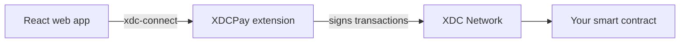

<p align="center">
  
</p>

<p align="center">
  
      
</p>

<p align="center">
  <a href="#steps">Steps</a> · <a href="#what-this-repo-contains">What this repo contains</a>
</p>

This tutorial walks through connecting a React web app to the XDCPay browser wallet, then deploying a small login-token contract for the site to use.

> [!NOTE]
> This was written in 2022 and hasn't been re-run in this review. Package and wallet versions may have changed.



## Steps

### 1. Install the dependency

```bash
npm i xdc-connect
```

### 2. Connect the wallet

Add the connect button to your React app. Once it works, add functions here that call your contract.

```jsx
import React, { useState } from "react";
import { XdcConnect, Disconnect } from "xdc-connect";
import "./App.css";

function App() {
  const [wallet, setwallet] = useState({});

  return (
    <div className="App">
      <XdcConnect
        btnClass={wallet.connected ? "btn btn-rounded btn-success" : "btn btn-rounded btn-warning"}
        btnName={wallet.connected ? "CONNECTED" : "CONNECT"}
        onConnect={(wallet) => setwallet(wallet)}
        onDisconnect={(wallet) => setwallet(wallet)}
      />
      {wallet.connected ? <button onClick={Disconnect}>Logout</button> : ""}
    </div>
  );
}

export default App;
```

### 3. Write a contract

In this example, a user can only log in if they hold the login token. Any existing contract can be used in the same way, including ones you didn't write.

```solidity
// SPDX-License-Identifier: MIT
pragma solidity ^0.8.0;

import "@openzeppelin/contracts/token/ERC1155/ERC1155.sol";

contract LoginTokenExample is ERC1155 {
    uint256 public constant LoginToken = 0;

    constructor() ERC1155("Login Token Example") {
        _mint(msg.sender, LoginToken, 1, "");
    }

    modifier OnlyLogin {
        require(balanceOf(msg.sender, LoginToken) >= 1, "require Login token to login");
        _;
    }

    function checkLogin() public view OnlyLogin returns (bool) {
        return true;
    }
}
```

### 4. Deploy with Remix

1. Install the XDCPay browser extension and write the contract in [Remix](https://remix.ethereum.org).
2. Select the Injected Provider environment. It should show `Custom (50)` on mainnet or `Custom (51)` on the Apothem testnet.
3. Deploy the contract and sign the transaction in XDCPay.
4. Confirm the contract on an XDC block explorer.

| Connect XDCPay | Deploy the contract |
| --- | --- |
|  |  |

### 5. Test the app

Call your contract's functions from the app and sign them in XDCPay. If one fails, check that the functions in your app match the ones in the contract.

## What this repo contains

| File | What it is |
| --- | --- |
| [`app.js`](app.js) | The React component from step 2, to copy into a React app |
| [`index.html`](index.html), [`style.css`](style.css) | A placeholder page. It doesn't run the React component by itself |

<details>
<summary><strong>More XDC projects</strong></summary>

| Group | Project | What it is |
| --- | --- | --- |
| Standards | [XRC-SHARES](https://github.com/CoinClubQuincy/XRC-SHARES) | Dividend-paying NFT shares and SPLITS for a DApp |
| Standards | [XRCDividendPlus](https://github.com/CoinClubQuincy/XRCDividendPlus) | Dividend-paying XRC-20 token |
| Treasury and finance | [Multi-Sig-Treasury](https://github.com/CoinClubQuincy/Multi-Sig-Treasury) | Treasury controlled by tokenized keys |
| Treasury and finance | [XRC-Airdrop](https://github.com/CoinClubQuincy/XRC-Airdrop) | Self-run token airdrop |
| Treasury and finance | [XRC-Credit](https://github.com/CoinClubQuincy/XRC-Credit) | Debt contract skeleton |
| Treasury and finance | [XDC-Defi-Instruments](https://github.com/CoinClubQuincy/XDC-Defi-Instruments) | Assets, agreements, forwards, futures and a marketplace |
| Identity and access | [LoginMFAContract](https://github.com/CoinClubQuincy/LoginMFAContract) | Login with a password and an NFT |
| Identity and access | [PrivateAccessToken](https://github.com/CoinClubQuincy/PrivateAccessToken) | Token-gated contract data demo |
| Identity and access | [Delegated_Authority](https://github.com/CoinClubQuincy/Delegated_Authority) | KYC notary proof of concept |
| Learning and libraries | [XDC-LemonadeStand](https://github.com/CoinClubQuincy/XDC-LemonadeStand) | Workshop DApp built on XRC-SHARES |
| Learning and libraries | [Non-Financial-SmartContracts](https://github.com/CoinClubQuincy/Non-Financial-SmartContracts) | Games, inventory, keys and on-chain repositories |
| Tools | [XDC_Python_SDK_V1](https://github.com/CoinClubQuincy/XDC_Python_SDK_V1) | Python client for the XDC JSON-RPC API |
| Tools | [PrivateXDCNode_SetupScript](https://github.com/CoinClubQuincy/PrivateXDCNode_SetupScript) | Private XDC network setup scripts |
| Multi-chain | [CoinClub_Framework](https://github.com/CoinClubQuincy/CoinClub_Framework) | Python library with an XDC adapter |
| Interfaces | [Contract_Interface_Model_Language](https://github.com/CoinClubQuincy/Contract_Interface_Model_Language) | Interface documents for smart contracts and APIs |

</details>

## License

This repository has no license file yet, so default copyright applies.
