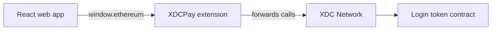

<p align="center">
  
</p>

<p align="center">
  
<a href="https://github.com/CoinClubQuincy/WebApp_to_XDCPay/actions/workflows/build.yml"></a>        
</p>

<p align="center">
  <a href="#Run it">run-it</a> · <a href="#The tutorial">the-tutorial</a> · <a href="#What is tested">what-is-tested</a> · <a href="#Known issues">known-issues</a>
</p>

This tutorial connects a React web app to the XDCPay browser wallet, then checks a login token held in a small smart contract. The repository is the finished example, so you can run it first and then read how each part works.

> [!NOTE]
> This has been tested in Chrome with a test wallet connected to a local chain, not with the XDCPay extension itself. See [What is tested](#what-is-tested).



## Run it

```bash
git clone https://github.com/CoinClubQuincy/WebApp_to_XDCPay.git
cd WebApp_to_XDCPay
pnpm install
pnpm dev
```

Open the address it prints. Without a wallet, the page shows a link to install XDCPay. With a wallet, follow these steps:

1. Choose **Connect wallet**, and approve it in the wallet.
2. Paste the address of your [deployed contract](#3-deploy-with-remix). To fill this in automatically, set `VITE_LOGIN_TOKEN_ADDRESS` in `.env.local`.
3. Choose **Check login**.

## The tutorial

### 1. Connect the wallet

XDCPay adds a standard provider (EIP-1193) to the page as `window.ethereum`. The app needs no wallet library, and the code is in [`src/wallet.ts`](src/wallet.ts).

```ts
export async function connect(provider: WalletProvider): Promise<string> {
  try {
    const accounts = await provider.request({ method: "eth_requestAccounts" });
    if (!Array.isArray(accounts) || typeof accounts[0] !== "string") {
      throw new WalletError("The wallet did not share an account");
    }
    return accounts[0];
  } catch (error) {
    if (codeOf(error) === USER_REJECTED) {
      throw new WalletError("The connection was declined in the wallet");
    }
    throw error;
  }
}
```

[`src/App.tsx`](src/App.tsx) also listens for `accountsChanged` and `chainChanged`, so the page follows the wallet. If the wallet is on another network, the app offers to switch to Apothem.

> [!TIP]
> XDC tools often write addresses as `xdc123...`, but RPC calls need `0x123...`. `toHexAddress` converts them.

### 2. Write a contract

In this example, a user can only log in if they hold the login token. The deployer receives the only token, and can transfer it. The code is in [`contracts/LoginToken.sol`](contracts/LoginToken.sol).

```solidity
contract LoginTokenExample is ERC1155 {
    uint256 public constant LoginToken = 0;

    constructor() ERC1155("Login Token Example") {
        _mint(msg.sender, LoginToken, 1, "");
    }

    modifier OnlyLogin() {
        require(balanceOf(msg.sender, LoginToken) >= 1, "require Login token to login");
        _;
    }

    function checkLogin() public view OnlyLogin returns (bool) {
        return true;
    }
}
```

### 3. Deploy with Remix

1. Install the XDCPay browser extension, and paste the contract into [Remix](https://remix.ethereum.org).
2. Select the Injected Provider environment. It should show `Custom (50)` on mainnet or `Custom (51)` on the Apothem testnet.
3. Deploy the contract, and sign the transaction in XDCPay.
4. Find the contract on [XDCScan](https://xdcscan.com) or its [testnet version](https://testnet.xdcscan.com).

| Connect XDCPay | Deploy the contract |
| --- | --- |
|  |  |

### 4. Call the contract

`checkLogin` in `src/wallet.ts` sends the function's selector with `eth_call`. A revert from the contract means the account has no token.

The app also checks the reply. A call to an address with no contract succeeds and returns `0x`, so treating every success as a login would be a bug.

## What is tested

The contract has 5 tests in [`test/foundry/LoginToken.t.sol`](test/foundry/LoginToken.t.sol). The web app has 30 tests in [`src/`](src), using a fake wallet. Both run in CI on every push, along with a production build.

| Tested | Not tested |
| --- | --- |
| The contract's login rule, and a login moving with the token | The XDCPay extension itself |
| The selector in the web app matching the contract | A real network, testnet or mainnet |
| Connecting, declining, changing account or network, and switching network | An independent security audit |
| Wrong addresses and failed calls never showing as a login | |

The built app was also run once by hand in headless Chrome, with a test wallet connected to the contract on a local Anvil chain. It gave the right result for the token holder, another account, an address with no contract and a browser with no wallet.

To check it with the real extension, install XDCPay, switch to Apothem and follow [Run it](#run-it).

## Changes from earlier versions

- The repository now holds a working app. It used to hold a copy of the React component and a placeholder page that couldn't run it.
- The app uses the wallet's standard provider instead of [`xdc-connect`](https://www.npmjs.com/package/xdc-connect). That package still installs, but its last release was in 2022, it expects React 17, it adds about 2,000 packages (428 MB) and it failed a default Vite build because it needs a Sass compiler.
- The contract moved out of the README into `contracts/`, with tests.
- 69 tracked `node_modules` files were removed, and the app now has a lockfile.

## Known issues

| Issue | Effect |
| --- | --- |
| `checkLogin` is not authentication | The app only asks whether an address holds the token. Anyone can name any address in `eth_call`, so a server must ask the user to sign a message instead of trusting this result |
| Other wallets work too | Any wallet that provides `window.ethereum` can use this page, including MetaMask |
| Revert messages vary between nodes | The app looks for `revert` in the error. A node that words it differently would show an error instead of "does not hold" |
| "Forget this account" only clears the page | A page can't disconnect a wallet. Do that in the wallet |

<details>
<summary><strong>More XDC and EVM projects</strong></summary>

| Group | Project | What it is |
| --- | --- | --- |
| Standards | [XRC-SHARES](https://github.com/CoinClubQuincy/XRC-SHARES) | Dividend-paying NFT shares and SPLITS for a DApp |
| Standards | [XRCDividendPlus](https://github.com/CoinClubQuincy/XRCDividendPlus) | Dividend-paying XRC-20 token |
| Treasury and finance | [Multi-Sig-Treasury](https://github.com/CoinClubQuincy/Multi-Sig-Treasury) | Treasury controlled by tokenized keys |
| Treasury and finance | [XRC-Airdrop](https://github.com/CoinClubQuincy/XRC-Airdrop) | Self-run token airdrop |
| Treasury and finance | [XRC-Credit](https://github.com/CoinClubQuincy/XRC-Credit) | Single-loan credit contract |
| Treasury and finance | [XDC-Defi-Instruments](https://github.com/CoinClubQuincy/XDC-Defi-Instruments) | Assets, agreements, forwards, futures and a marketplace |
| Treasury and finance | [XRC1155-Equities-Market](https://github.com/CoinClubQuincy/XRC1155-Equities-Market) | Shares, portfolios and a marketplace on ERC-1155 |
| Treasury and finance | [NFTOTC](https://github.com/CoinClubQuincy/NFTOTC) | Over-the-counter sale of a token collection |
| Treasury and finance | [DAppProxySwap](https://github.com/CoinClubQuincy/DAppProxySwap) | Currency swaps for a DApp through a fixed router |
| Identity and access | [LoginMFAContract](https://github.com/CoinClubQuincy/LoginMFAContract) | Login with an NFT and a signed second factor |
| Identity and access | [PrivateAccessToken](https://github.com/CoinClubQuincy/PrivateAccessToken) | Token access to encrypted off-chain data |
| Identity and access | [Delegated_Authority](https://github.com/CoinClubQuincy/Delegated_Authority) | KYC notary proof of concept |
| Identity and access | [EncryptedNFT-Documents](https://github.com/CoinClubQuincy/EncryptedNFT-Documents) | NFTs tied to encrypted off-chain documents |
| Learning and libraries | [XDC-LemonadeStand](https://github.com/CoinClubQuincy/XDC-LemonadeStand) | Workshop DApp built on XRC-SHARES |
| Learning and libraries | [Non-Financial-SmartContracts](https://github.com/CoinClubQuincy/Non-Financial-SmartContracts) | Games, inventory, keys and on-chain repositories |
| Learning and libraries | [ContractLedger](https://github.com/CoinClubQuincy/ContractLedger) | On-chain list of contract addresses |
| Learning and libraries | [TimestampConverter](https://github.com/CoinClubQuincy/TimestampConverter) | Timestamps to calendar dates in Solidity |
| Tools | [XDC_Python_SDK_V1](https://github.com/CoinClubQuincy/XDC_Python_SDK_V1) | Python client for the XDC JSON-RPC API |
| Tools | [PrivateXDCNode_SetupScript](https://github.com/CoinClubQuincy/PrivateXDCNode_SetupScript) | Private XDC network setup scripts |
| Multi-chain | [CoinClub_Framework](https://github.com/CoinClubQuincy/CoinClub_Framework) | Python library with an XDC adapter |
| Interfaces | [Contract_Interface_Model_Language](https://github.com/CoinClubQuincy/Contract_Interface_Model_Language) | Interface documents for smart contracts and APIs |

</details>

## License

[MIT](LICENSE).
